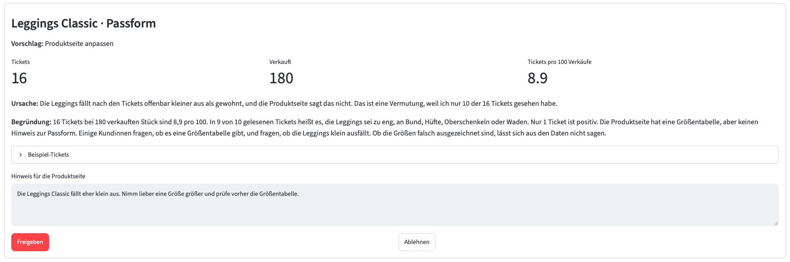
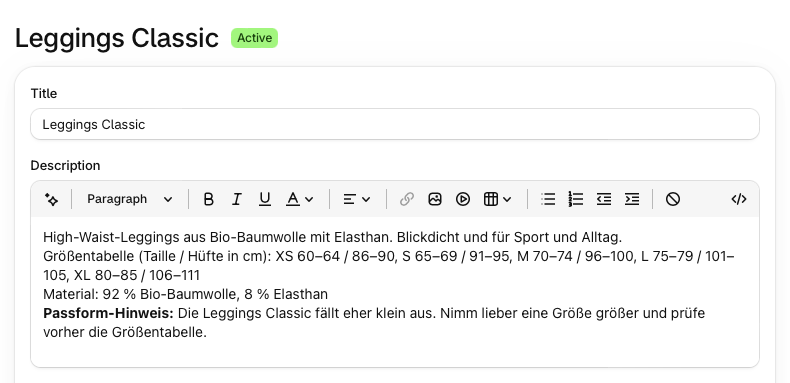
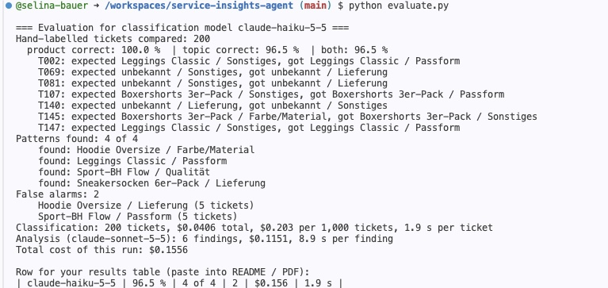

# Service Insights Agent

> Turns repetitive customer service tickets into concrete product improvements.

Customer service teams answer the same questions again and again, while the root cause stays in place:
a missing fit note, a weak seam, a delayed carrier. This agent reads service tickets, finds recurring
problems per product and proposes a fix in the right place:

- a **fit note on the product page** in Shopify (for example "runs small, order one size up"),
- a **message to product management** for quality issues,
- a **message to supply chain** for delivery issues.

A person approves every proposal before anything changes.



After approval, the fit note goes live on the product page via the Shopify Admin API:



## Results

Test data: 200 synthetic tickets for a fictional basics brand (6 products), with 4 hidden problem patterns.
Tickets and labels (product and topic) were generated with Claude, then reviewed by hand; the agent is measured against these labels.

| Version | Change | Topic correct | Product correct | Patterns found | False alarms | Cost per run | Time per ticket |
|---|---|---|---|---|---|---|---|
| V1 | First prompt | 83.0 % | 99.5 % | 4 of 4 | 5 | $0.21 | 1.7 s |
| V2 | Explicit topic definitions | **96.5 %** | **100 %** | **4 of 4** | **2** | **$0.16** | 1.9 s |

Classification costs about **$0.20 per 1,000 tickets** with Claude Haiku 5.5.

**What changed from V1 to V2.** Most V1 errors were not model mistakes but unclear categories:
is "Can I change my delivery address?" a delivery topic or "other"? Is a pre-purchase size question about fit?
I wrote explicit topic definitions, applied them to the labels (keyword search across all 200 tickets, then a manual decision per candidate) and
added the same definitions to the classification prompt. The error rate dropped from 17 % to 3.5 %,
and the run got cheaper because fewer false alarms reached the expensive analysis step.



## How it works

```
Tickets ─> 1 Classify ─────> 2 Cluster (SQL) ─────────> 3 Analyse ────────────────> 4 Human approval
           Claude Haiku      tickets per 100 units      Claude Sonnet with tools      Streamlit app
                             sold, flags outliers       proposes an action            writes to Shopify
```

| Step | File | What happens |
|---|---|---|
| 1 | `classify.py` | Claude Haiku assigns product, topic, detail and sentiment to each ticket |
| 2 | `cluster.py` | SQL counts tickets per product and topic, relative to units sold, and flags outliers |
| 3 | `analyze.py` | An agent with three tools (product info, sales, example tickets) decides itself which data it needs and proposes an action |
| 4 | `app.py` | Approval page; approved fit notes are written to the product page via the Shopify Admin API |
| 5 | `evaluate.py` | Measures accuracy, detected patterns, false alarms, cost and speed |

### Design choices

- **Small model for volume, large model for judgement.** Haiku classifies every ticket cheaply; Sonnet only looks at the few flagged groups.
- **Relative, not absolute counts.** Tickets are counted per 100 units sold, so a bestseller does not stand out just because it sells a lot.
- **The agent chooses its own data.** It calls tools for product details, sales and example tickets as needed.
- **Human in the loop.** Nothing is published without approval.
- **Privacy.** No names or e-mail addresses are sent to the model.
- **Complements existing helpdesk tools** such as Zendesk instead of replacing them: their tickets are the input.

## Limitations

- **Synthetic data.** Tickets, products and sales are invented; real tickets are messier.
- **Small sample.** 200 tickets and 4 patterns; the threshold (5 tickets) was not calibrated on real data. Both remaining false alarms sit exactly on that threshold.
- **The agent rarely says "no action needed".** For the two false alarms it still proposed an action. One of them was actually useful: the sports bra size chart only lists the underbust, so customers ask about cup sizes.
- **Ambiguous tickets.** Praise like "fits perfectly" is sometimes read as a fit topic, and some tickets mix two requests. Humans disagree on these too.
- **Sales figures come from `data/shop.json`.** Shopify treats order data as protected customer data that requires separate approval. Products are read from and written to Shopify; in production, sales would come from the data warehouse.
- **Example tickets are capped at 10 per finding**, so the agent does not see every ticket of a large group (it says so in its reasoning).

## Next steps

- Calibrate the threshold on real ticket volumes and add explicit criteria for "no action needed".
- Run weekly on a Zendesk export, with sales from the data warehouse.
- Send team messages via Slack instead of Markdown files.
- Measure impact: do tickets drop after a fit note goes live?

## Setup

Runs in GitHub Codespaces, nothing to install locally.

1. Add Codespaces secrets: `ANTHROPIC_API_KEY`; for Shopify also `SHOPIFY_SHOP`, `SHOPIFY_CLIENT_ID`, `SHOPIFY_CLIENT_SECRET` and `DATA_SOURCE=shopify`.
2. `pip install -r requirements.txt`
3. Run the pipeline:

```bash
python prepare_data.py   # splits data/generated.csv into tickets and labels
python classify.py
python cluster.py
python analyze.py
streamlit run app.py
python evaluate.py
```

Without Shopify secrets, everything runs on `data/shop.json`. A small sample is in `data/sample/`.

## Built with

Python, Claude API (Haiku 5.5, Sonnet 5.5), Shopify Admin GraphQL API, SQLite, Streamlit, GitHub Codespaces.
Built with the help of AI tools (Claude) for code and test ticket generation. Concept, label review, evaluation and design decisions are my own.